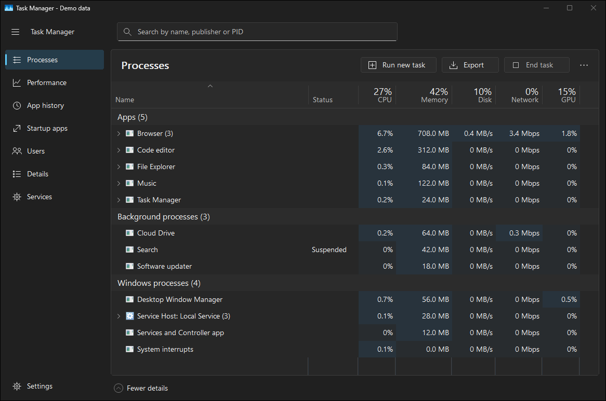
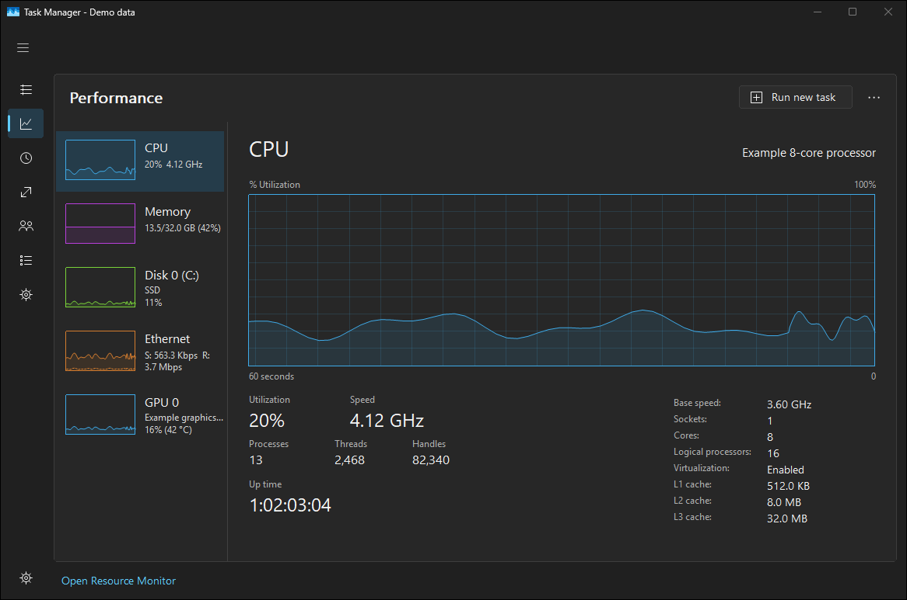

# Native interface redesign

The redesign keeps the C++ sampler, process identity model and virtual owner-data ListView, and changes how the application presents them. The shell uses Windows controls with GDI/GDI+ painting. It adds no web engine, .NET dependency or separately installed UI runtime.

## Layout and interaction

The seven sections now live in a collapsible sidebar. Each section is a native radio control with an accessible name and checked state. One section participates in the Tab order; arrow keys and Home/End move within the group. Ctrl+Tab and Alt+1 through Alt+7 retain direct page navigation. Bursts of navigation requests still commit only the final requested section.

Search remains visible on table pages. Ctrl+F focuses and selects the current query; Enter applies it and focuses the results; Escape clears it and returns to the list. The native Edit retains text editing, selection and caret behavior. Its placeholder uses the theme's muted foreground in both normal painting and screenshot capture, so dark mode does not inherit an unreadable system cue color.

The page command bar exposes Run new task, Export and the applicable task action. More actions preserves File, Options and View, and Settings opens Options directly. F10 and Alt+F/O/V provide keyboard access; Alt+Space retains the native window menu. Narrow windows keep the overflow available and move less common commands into it.

Fresh interactive windows start at 1180 × 780 DIPs, scaled to their monitor and constrained to its work area. Saved window rectangles retain their existing physical coordinates. The navigation is 208 DIPs wide when expanded and 64 when collapsed. It collapses automatically below the available width, and earlier on Performance to make room for the resource list. Compact and Performance summary modes remain available. Focus moves to visible, enabled content when a layout change hides or disables the previously focused control.

The primary font is Segoe UI at 14 DIPs, with a 20-DIP semibold page heading. General table rows are 32 DIPs high; Details, Services and compact rows use 28. Fresh Processes settings show Name, Status, CPU, Memory, Disk, Network and GPU, totaling 902 DIPs. The 380-DIP Name column gives long task labels more room. Existing saved widths, order and visibility take precedence; GPU engine and power estimates remain in the column chooser.

## Painting and resource use

Light and dark surfaces, foregrounds, borders and selection colors share explicit semantic roles. High Contrast uses Windows system colors, including the matching foreground for highlighted navigation. Heat cells use separate static light/dark palettes.

The changes preserve the existing selective row invalidation path, PID/creation-time identity handling, cached sorting, metadata workers, resource sampling cadence and recovery behavior. They also remove work from painting and shell updates:

- Heat cells index static colors directly and no longer draw two extra blended edge strips per cell.
- Header separators use a single fill instead of a per-pixel gradient.
- Empty fallback cells are constructed once per row instead of once per displayed cell.
- Shell hover redraws occur on state transitions and affect the relevant control.
- Layout avoids unchanged moves and visibility calls; normal process sampling does not relayout the shell.
- Action labels and enabled states update only when their values change.

The original TabControl remains hidden as a logical selection backend for existing commands and diagnostics. It has no Tab stop, and no redraw-enable operation can accidentally reveal it. New fonts and the detached menu tree have explicit destruction paths. Glyph painting restores GDI state and uses no external icon-font dependency.

## Verification and reproducible previews

The native suite checks selected radio state and Tab stops, pointer and keyboard navigation, coalescing, every section at minimum and wide window sizes, control bounds and overlap, persistent search, compact/summary restoration, High Contrast rendering and focus relocation. Shell-only interactions must retain the current sample and table storage. Existing selection, sorting, scrolling, DPI, resource and recovery checks remain in place.

To build and run the optimized native gates:

```text
python tools/taskmgr.py build --test-configuration Release
```

To capture the actual renderer with shareable example data:

```text
python tools/taskmgr.py screenshots --demo-data
```

This produces 19 views in each theme and a report identifying `dataSource: synthetic`. The fixture replaces the sampler before its thread starts and disables icon workers. It supplies synthetic processes, accounts, startup entries, hardware and network addresses, and labels the window **Task Manager - Demo data**. The displayed figures are examples. All fixture and capture code is excluded from production.





## Performance comparison

The comparison uses the preserved main build at `68201184b3afaa7a67ea6b367554bd7d25873a79` and the redesigned native build, compiled with the same MSVC/CMake Release configuration on the same Windows 11 PC. Production sizes are recorded separately from the diagnostic executables used to measure CPU, memory and UI timings.

```text
python tools/taskmgr.py compare --baseline-executable artifacts/baseline/TaskManager.dev.exe --baseline-production-executable artifacts/baseline/TaskManager.exe --production-executable artifacts/app/TaskManager.exe --repetitions 3 --samples 500 --seconds 15 --warmup-seconds 5 --theme-comparison
```

The command runs eight scenarios serially, alternating baseline/candidate order in each repetition. It retains raw reports, executable hashes, medians and observed ranges. Hidden measurement windows remain 1010 × 875 DIPs in both builds. UI measurements use a one-second polling interval. Sampler measurements use 500 saturated samples after ten warmup samples. CPU percentages use one logical core as 100%.

The one-second workload differs from fresh interactive Adaptive polling. Three repetitions show observed variability rather than statistical confidence. Sampler CPU milliseconds per sample measures CPU cost; elapsed milliseconds per sample also includes waits. Private bytes represent committed private memory, while working set represents resident memory. Diagnostic memory can retain allocations from verification, and peak working set includes startup and verification.

Live CPU, update and paint counters reset after verification. Some interaction measurements, including column resizing, Performance hover and tab switching, also include verification exercises. Reported p95 comparisons use the median of each run's p95, rather than a percentile pooled across all runs.

The default table presentation changed: the redesign has fewer initially visible columns and taller rows. Consequently, UI timing differences describe the complete default redesign, including the different number of visible cells; they do not isolate the cost of one painting optimization. Process population, driver behavior, background load and heap retention also affect results. Synthetic screenshot values are never benchmark inputs.

Measured results, executable identities and verification outcomes are recorded in [PR #43](https://github.com/ProtonDev-sys/task-manager/pull/43). Native keyboard/system-color and DPI checks cover specific application behavior; they do not establish a complete screen-reader or physical multi-monitor audit.
